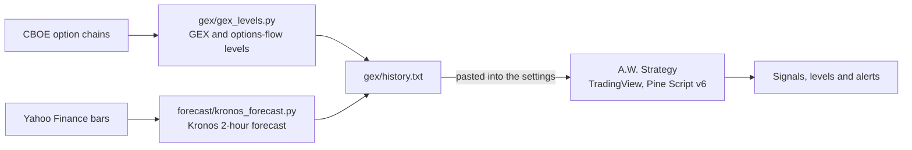

# A.W. Strategy

[](https://github.com/abdulwh1d/claude-trading-bot/actions/workflows/gex-levels.yml)


A rules-based intraday futures strategy for TradingView, with an automated options-data pipeline
and a paper-trading research bot.

A.W. Strategy trades index and metal futures (NQ/MNQ, ES/MES, RTY, YM, GC/MGC) on 5 to 30 minute
charts. A trade needs three things to line up: **market structure** in its favour, a **reaction at
a level** (the 79% retracement or a fair value gap) and **order flow** behind it (intrabar delta,
its z-score and a flow score). Dealer gamma (GEX) levels and the day's busiest option strikes,
computed from CBOE data during the session, are drawn on the chart, ranked, each with a plan.

> Research and engineering, not financial advice. Trade it on paper first.

## How it trades

| Step | Rule |
|---|---|
| Context | The last break of structure (5-bar swings) goes the trade's way and the 30-minute chart agrees. |
| Location | Price touches the 79% retracement of the impulse leg or a fair value gap, and the candle closes back off it. |
| Confirmation | Gap reactions, intrabar delta (z-score, buyers' share, cumulative delta) and relative volume. |
| Timing | London and New York sessions only. |
| Signal | At least 5 of 8 factors, on candle close (no repainting). |
| Risk | Stop beyond the reaction candle and its zone plus 0.25 ATR, skipped if wider than 3 ATR. Targets at 1R and 2R, stop to breakeven after 1R, early exit on a structure flip or broken order flow. |

On the chart: delta, the flow score and the delta z-score next to the script's name (no tables
covering the chart), the signals, and the GEX walls, gamma flip and 8 biggest strikes ranked #1 to
#8 alongside today's busiest option strikes (OV #1 to #4). Hover any level for its plan.

Ten more playbooks run alongside it (breakout, pullback, range, mean reversion, news, spread,
scalping, order flow, GEX + order flow, GEX + anchored VWAP), each with its own signals and record.
Full details: [docs/strategy.md](docs/strategy.md).

## Architecture



A GitHub Action refreshes the levels during the session ([docs/data-pipeline.md](docs/data-pipeline.md)).
The paper-trading bot is a separate research project on stocks ([docs/paper-bot.md](docs/paper-bot.md)).

## Quick start

**TradingView**

1. Open the Pine Editor, paste [`tradingview/aw_strategy.pine`](tradingview/aw_strategy.pine),
   save it as "A.W. Strategy" and click "Add to chart".
2. Paste [`gex/history.txt`](gex/history.txt) into the settings under GEX levels. Paste it again
   for the newest levels.
3. Create one alert on "A.W. Strategy" with "Any alert() function call" to get every entry and
   exit with its stop and target.
4. Optional: [`tradingview/hap_avwap_english.pine`](tradingview/hap_avwap_english.pine), the
   HaP AVWAP indicator translated into English.

**Data pipeline**

```
python gex/gex_levels.py              # GEX and options-flow levels from CBOE
python forecast/kronos_forecast.py    # Kronos forecasts (needs torch and forecast/requirements.txt)
```

**Tests**

```
pip install -r requirements.txt
pytest
```

## Repository layout

```
tradingview/aw_strategy.pine          A.W. Strategy (Pine Script v6)
tradingview/hap_avwap_english.pine    HaP AVWAP / Anchored VWAP in English (MPL-2.0)
gex/                                  GEX and options-flow levels, and the files pasted into TradingView
forecast/                             Kronos forecasts, the vendored model (MIT) and the forecast log
tradebot/, bot.py, config.py          Paper-trading research bot (Alpaca paper account)
tests/                                84 tests: GEX math, forecast scoring, the bot's risk rules and more
docs/                                 Strategy, data pipeline and bot documentation
.github/workflows/                    The scheduled GEX and forecast run
```

## Credits

| Project | Used for |
|---|---|
| [SuperFlow](https://github.com/profitnotiondaily/atasx-superflow) | The flow score's parts and weights |
| [OrderFlowMap](https://github.com/Azhagesan-dev/OrderFlowMap) | Big-print bubbles |
| [gex-explained](https://github.com/FlashAlpha-lab/gex-explained), [Options-Gamma-Exposure-Analysis-Tool](https://github.com/CodeCraftIA/Options-Gamma-Exposure-Analysis-Tool) | The GEX math |
| [Kronos](https://github.com/shiyu-coder/Kronos) | The 2-hour forecast |
| "Stop Guessing If a Gamma Exposure (GEX) Level Will Reverse — Use AVWAP", Grateful Futures Trading University | The GEX + anchored VWAP playbook |
| HaP AVWAP / Anchored VWAP by agahakanaga (MPL-2.0) | Translated into English in `tradingview/hap_avwap_english.pine` |

Looked at and not used: [nautilus_trader](https://github.com/nautechsystems/nautilus_trader) and
[Nautilus-Web-Interface](https://github.com/Black101081/Nautilus-Web-Interface) (a full trading
engine and its web UI; the natural next step for automated execution or tick-level backtests),
[prediction-market-backtesting](https://github.com/evan-kolberg/prediction-market-backtesting)
(prediction markets, not futures) and [skfolio](https://github.com/skfolio/skfolio) (portfolio
allocation across many assets).
