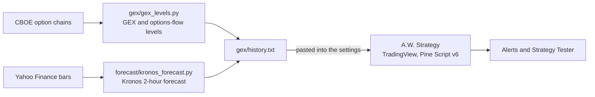

# A.W. Strategy

[](https://github.com/abdulwh1d/claude-trading-bot/actions/workflows/gex-levels.yml)


A rules-based intraday futures strategy for TradingView, with an automated options-data pipeline
and a paper-trading research bot.

A.W. Strategy trades index and metal futures (NQ/MNQ, ES/MES, RTY, YM, GC/MGC) on 1 to 30 minute
charts. A trade needs three things to line up: **market structure** in its favour, a **reaction at
a level** (a 79% retracement, a fair value gap, a swing anchored VWAP or a volume-profile level)
and **order flow** behind it (intrabar delta, its z-score and a flow score). Dealer gamma (GEX)
levels and the day's busiest option strikes, computed from CBOE data every 30 minutes, mark where
price is likely to turn.

> Research and engineering, not financial advice. The strategy has not shown an edge after costs
> (see [Results](#results)). Trade it on paper.

## How it trades

| Step | Rule |
|---|---|
| Context | The last break of structure (5-bar swings) goes the trade's way and the 30-minute chart agrees. Major structure (20-bar swings) and the swing-AVWAP regime add to the score. |
| Location | Price touches the 79% retracement of the impulse leg, a fair value gap, the swing anchored VWAP or a volume-profile support/resistance, and the candle closes back off it. |
| Confirmation | Gap reactions, intrabar delta (z-score, buyers' share, cumulative delta), relative volume and a −1 to +1 flow score. |
| Timing | London and New York sessions only. |
| Signal | At least 7 of 10 factors, on candle close (no repainting). |
| Risk | Stop beyond the reaction candle and its zone plus 0.25 ATR, skipped if wider than 3 ATR. Targets at 1R and 2R, stop to breakeven after 1R, early exit on a structure flip or broken order flow. One contract per trade in the Strategy Tester. |

Ten more playbooks run alongside it (breakout, pullback, range, mean reversion, news, spread,
scalping, order flow, GEX + order flow, GEX + anchored VWAP), each with its own record, and any of
them can be backtested in the Strategy Tester. Full details: [docs/strategy.md](docs/strategy.md).

## Results

TradingView Strategy Tester, default settings, one contract, $1.25 commission per contract per
order and 1 tick of slippage, run on October 29, 2026:

| Market | Chart | Period | Trades | Won | Profit factor | Net | Max drawdown |
|---|---|---|---|---|---|---|---|
| MNQ | 15 min | Apr 30 – Oct 29, 2026 | 281 | 31.3% | 0.99 | −$206 | $2,559 |
| NQ | 5 min | Sep 6 – Oct 29, 2026 | 177 | 31.1% | 0.97 | −$1,959 | $13,156 |
| ES | 5 min | Sep 6 – Oct 29, 2026 | 162 | 26.5% | 0.82 | −$4,667 | $5,476 |

Roughly breakeven on 15-minute MNQ and losing on 5-minute NQ and ES after costs. Longs did better
than shorts over this rising market (MNQ 15 minutes: profit factor 1.25 long, 0.80 short). The
minimum score of 7 was the best of four settings tested on the same data, which flatters it; see
[docs/strategy.md](docs/strategy.md#backtest-results).

## Architecture



A GitHub Action refreshes the levels during the session ([docs/data-pipeline.md](docs/data-pipeline.md)).
The paper-trading bot is a separate research project on stocks ([docs/paper-bot.md](docs/paper-bot.md)).

## Quick start

**TradingView**

1. Open the Pine Editor, paste [`tradingview/aw_strategy.pine`](tradingview/aw_strategy.pine),
   save it as "A.W. Strategy" and click "Add to chart".
2. Paste [`gex/history.txt`](gex/history.txt) into the settings under GEX levels.
3. Create one alert on "A.W. Strategy" with "alert() function calls only" to get every entry and
   exit with its stop and target.

**Data pipeline**

```
python gex/gex_levels.py              # GEX and options-flow levels from CBOE
python forecast/kronos_forecast.py    # Kronos forecasts (needs torch and forecast/requirements.txt)
```

**Tests**

```
pip install -r requirements.txt
pytest
```

## Repository layout

```
tradingview/aw_strategy.pine   A.W. Strategy (Pine Script v6)
gex/                           GEX and options-flow levels, and the files pasted into TradingView
forecast/                      Kronos forecasts, the vendored model (MIT) and the forecast log
tradebot/, bot.py, config.py   Paper-trading research bot (Alpaca paper account)
tests/                         84 tests: GEX math, forecast scoring, the bot's risk rules and more
docs/                          Strategy, data pipeline and bot documentation
.github/workflows/             The scheduled GEX and forecast run
```

## Credits

The strategy rebuilds ideas from these open-source projects in its own code:

| Project | Used for |
|---|---|
| Market Structure by Leviathan | Major swings and breaks of structure |
| HaP AVWAP / Anchored VWAP by agahakanaga | Swing anchored VWAPs and their regime |
| Buyers & Sellers Profile + Dynamic S/R by Zeiierman | Volume-profile support and resistance |
| [SuperFlow](https://github.com/profitnotiondaily/atasx-superflow) | The flow score's parts and weights |
| [OrderFlowMap](https://github.com/Azhagesan-dev/OrderFlowMap) | Big-print bubbles |
| [gex-explained](https://github.com/FlashAlpha-lab/gex-explained), [Options-Gamma-Exposure-Analysis-Tool](https://github.com/CodeCraftIA/Options-Gamma-Exposure-Analysis-Tool) | The GEX math |
| [Kronos](https://github.com/shiyu-coder/Kronos) | The 2-hour forecast |
| "Stop Guessing If a Gamma Exposure (GEX) Level Will Reverse — Use AVWAP", Grateful Futures Trading University | The GEX + anchored VWAP playbook |

Looked at and not used: [nautilus_trader](https://github.com/nautechsystems/nautilus_trader) and
[Nautilus-Web-Interface](https://github.com/Black101081/Nautilus-Web-Interface) (a full trading
engine and its web UI; the natural next step for automated execution or tick-level backtests),
[prediction-market-backtesting](https://github.com/evan-kolberg/prediction-market-backtesting)
(prediction markets, not futures) and [skfolio](https://github.com/skfolio/skfolio) (portfolio
allocation across many assets).
