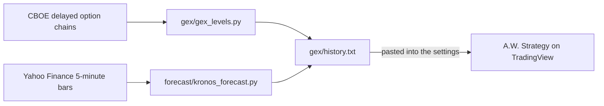

# Data pipeline: GEX, options flow and forecasts

Pine Script can't download data, so a GitHub Action computes the option-based levels and the
forecasts and commits them to [`gex/history.txt`](../gex/history.txt), which is pasted into
[A.W. Strategy](strategy.md)'s settings.



## Schedule

`.github/workflows/gex-levels.yml` runs before the US open and every 30 minutes through the
session on weekdays, then commits `gex/latest.txt`, `gex/history.txt` and `forecast/log.csv`.
GitHub delays or drops scheduled runs when it's busy (on some days in October 2026 only three of
the planned runs fired), so the schedule uses odd minutes; when fresh levels matter, run it by
hand from Actions → "GEX levels" → "Run workflow". It takes about three minutes.

## GEX levels

Gamma exposure (GEX) estimates where options dealers' hedging pushes price or pins it.
`gex/gex_levels.py` pulls CBOE's free, delayed option chains and computes, for each underlying:

- **GEX per contract** = gamma × open interest × 100 × spot² × 1%, calls positive and puts
  negative, expiries up to 60 days out, the way
  [Options-Gamma-Exposure-Analysis-Tool](https://github.com/CodeCraftIA/Options-Gamma-Exposure-Analysis-Tool)
  and [gex-explained](https://github.com/FlashAlpha-lab/gex-explained) do.
- **Gamma flip**: where total GEX changes sign as spot moves (a Black-Scholes sweep from −10% to
  +10%).
- **Call wall / put wall**: the strikes with the most positive and most negative GEX within 5% of
  spot.
- **Ladder**: every strike within 2% of spot holding at least 1% of the biggest one's GEX.

| Futures | Options used |
|---|---|
| ES / MES | SPX + SPY |
| NQ / MNQ | NDX + QQQ |
| RTY / M2K | RUT + IWM |
| YM / MYM | DIA + DJX |
| Gold, silver, crude, natural gas, bonds | GLD, SLV, USO, UNG, TLT (rougher stand-ins: the futures' own options aren't free) |

ETF chains are moved onto the index's scale with the same dollar gamma and added in, since much of
the hedging sits there (QQQ's open interest dwarfs NDX's). Strikes are grouped into 5-point (SPX,
RUT) and 25-point (NDX) buckets.

## Options-flow levels

Each snapshot also lists the 8 strikes within 2% of spot with the most option volume that day,
calls and puts separately, with ETF contracts counted in index-sized ones. They stand in for
TradingView's Options Volume Profile, which only draws on daily charts.

## Kronos forecasts

[Kronos](https://github.com/shiyu-coder/Kronos) is an open-source foundation model trained on
candlestick data from 45 exchanges. `forecast/kronos_forecast.py` runs Kronos-small (vendored under
`forecast/model/` with its MIT license) on the last 400 five-minute bars of NQ, ES, RTY, YM and
gold, averages 5 sampled paths for the next 2 hours, and scores every past 1-hour direction call
in `forecast/log.csv` once its hour has passed. If the forecast step fails, the GEX levels are
still committed.

## File format

One line per underlying per run, in the options' own prices:

```
2026-10-29T10:52 NDX spot=29442.60 flip=29735.32 cw=29675 pw=28775 total=-6.72 k=28875:-0.043,28900:-0.148,... v=29200:210/2778,...
2026-10-29T10:53 FC:NQ last=29560.75 c1h=29576.72 c2h=29636.10 hi=29652.43 lo=29508.83 hit=2/8
```

`k=` is strike:GEX in billions of dollars per 1% move, `v=` strike:call volume/put volume, `hit=`
the forecast's right/scored calls. `history.txt` keeps the first run of each day (it applies all
day) and each underlying's newest run, with the full ladder and the volume levels only on the
newest; older runs keep their 8 biggest strikes, which is all the signals use. It stays under
Pine's 40,960-character limit for one text input.

## Limits

GEX rests on assumptions about who is long and short the options (dealers long calls and short
puts), the chains are 15 minutes delayed and open interest updates once a day. There's no free
source of past GEX, so GEX-based records only build forward from October 21, 2026.

## Run it locally

```
python gex/gex_levels.py                    # writes gex/latest.txt and gex/history.txt
pip install torch --index-url https://download.pytorch.org/whl/cpu
pip install -r forecast/requirements.txt
python forecast/kronos_forecast.py          # adds the FC: lines
```
